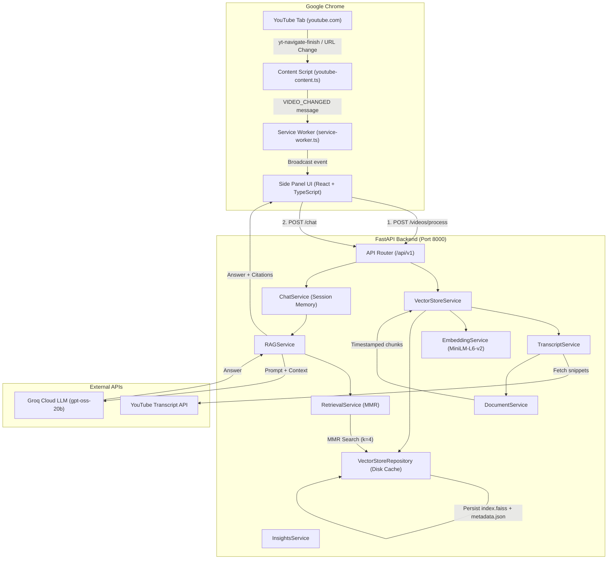

# YouTube AI Assistant — System Architecture

This document describes the high-level system architecture, data flow, component interactions, and security model of the **YouTube AI Assistant** application.

---

## 1. System Overview

YouTube AI Assistant provides real-time, transcript-grounded conversational AI for YouTube videos. It consists of:
1. **Chrome Extension (Manifest V3)**:
   - Content script detecting video ID and client-side SPA navigation.
   - Background service worker managing sidepanel lifecycle and routing messages.
   - React + TypeScript side panel UI providing the conversational interface.
2. **FastAPI Backend**:
   - YouTube transcript ingestion via `youtube-transcript-api`.
   - Chunking with timing metadata via LangChain `RecursiveCharacterTextSplitter`.
   - Local embeddings via `sentence-transformers/all-MiniLM-L6-v2`.
   - Persistent FAISS vector store with TTL caching.
   - Context retrieval using Maximal Marginal Relevance (MMR).
   - Answer and insight generation via Groq LLM (`openai/gpt-oss-20b`).

---

## 2. Component Architecture

---

## 3. Data Flow Lifecycles

### Video Detection & Ingestion Flow
1. User navigates to a YouTube video.
2. `youtube-content.ts` captures the event via `yt-navigate-finish` or URL mutation and validates the 11-character video ID.
3. Content script sends a `VIDEO_CHANGED` message to `service-worker.ts`.
4. `service-worker.ts` stores the current video in `chrome.storage.local` and relays it to `App.tsx` in the Side Panel.
5. `useVideoProcessing` checks `GET /api/v1/videos/{video_id}` to see if the video has already been indexed.
6. If not indexed, the user clicks **Process Video** (`POST /api/v1/videos/process`).
7. `TranscriptService` attempts to fetch official manual captions, falling back to auto-generated English captions.
8. `DocumentService` groups snippets into logical time blocks, retaining `start_seconds`, `end_seconds`, and video timestamp URLs on each chunk.
9. `EmbeddingService` generates dense vectors and saves a local FAISS index alongside a `metadata.json` descriptor in `backend/app/storage/{video_id}/`.

### Question Answering Flow
1. User types a question in the side panel and hits `Enter`.
2. `useChat` issues `POST /api/v1/chat` with `{ video_id, session_id, question }`.
3. `ChatService` retrieves the FAISS index for `video_id` and formats recent conversation history.
4. `RetrievalService` executes MMR search (`k=4`, `fetch_k=20`, `lambda_mult=0.5`) on the FAISS index to retrieve the most relevant and non-redundant excerpts.
5. `RAGService` formats the prompt with untrusted context protections and sends it to Groq LLM (`openai/gpt-oss-20b`).
6. Groq generates an answer grounded strictly in the context.
7. Citations are converted into typed `SourceReference` items and returned to the UI.
8. The UI renders the answer and clickable timestamp citation chips (e.g. `⏱ 04:12 - 04:45`).

---

## 4. Video Switching & Isolation

- **Conversation Isolation**: Every chat message is indexed by `video_id::session_id`. When the user navigates to another YouTube video, the side panel immediately clears active chat state and switches to the new video's context.
- **Stale Response Discarding**: `AbortController` instances in the frontend hooks abort pending requests upon video change. Any in-flight response returning after a video transition is verified against `activeVideoIdRef` and safely discarded if the ID does not match.

---

## 5. Security & Isolation

- **Prompt Injection Defense**: Transcripts from YouTube are treated as untrusted user input. System prompts explicitly mandate ignoring any instruction within transcripts to bypass guidelines, leak secrets, or act as an alternative persona.
- **Secret Redaction**: `GROQ_API_KEY` is loaded strictly on the backend from `.env`. The logging filter dynamically redacts the key from console output.
- **Safe Index Deserialization**: `FAISS.load_local` is only executed after checking `metadata.json` integrity, expiration timestamp, and model version compatibility.
- **CORS Restricted**: Local development origins and Chrome extension protocol are configured.

